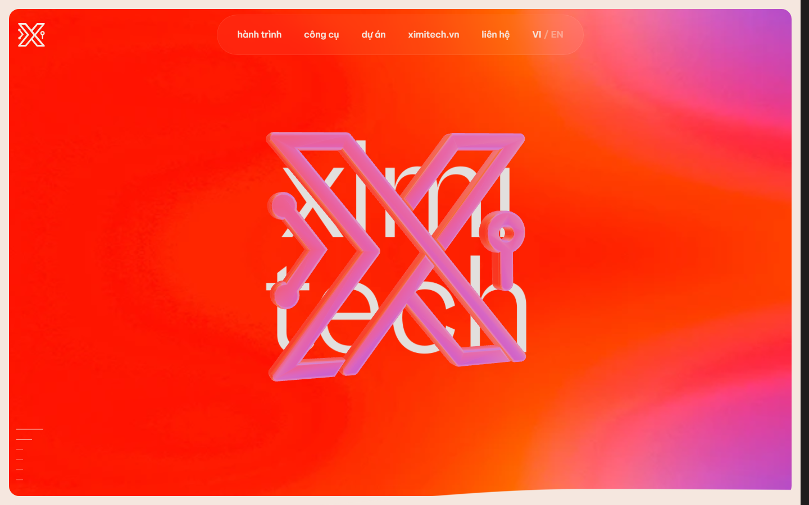

# Ximitech Lab - 3D Interactive Website

> Phiên bản clone website tương tác 3D sáng tạo của [Ximitech Lab](https://lab1.ximitech.vn/) với hiệu ứng WebGL, Three.js và âm thanh sinh động.

[](http://ximitechlab.kimidev.net/)
[](https://threejs.org/)
[](https://greensock.com/gsap/)

---

## 🌐 Trải nghiệm Trực tiếp (Live Demo)

- **Website Demo:** [http://ximitechlab.kimidev.net/](http://ximitechlab.kimidev.net/)
- **Bản gốc tham khảo:** [https://lab1.ximitech.vn/](https://lab1.ximitech.vn/)

---

## 📸 Hình ảnh Sản phẩm Thực tế (Preview)



---

## ✨ Tính năng Nổi bật

- **Tương tác 3D & WebGL Shaders:** Logo và hiệu ứng biến dạng hình ảnh (image distortion) mượt mà dựa trên Three.js & GLSL.
- **Hệ thống Âm thanh Tương tác (Sound FX):** Tích hợp hiệu ứng âm thanh sống động khi tương tác qua `ximitech-sound.js`.
- **Hiệu ứng Chuyển trang (Smooth Transitions):** Điều hướng mượt mà, dynamic page transitions với GSAP.
- **Đa ngôn ngữ (Bilingual):** Hỗ trợ chuyển đổi ngôn ngữ linh hoạt giữa Tiếng Việt và Tiếng Anh (VI / EN).
- **Thiết kế Đáp ứng (Responsive Design):** Tối ưu hóa hiển thị trên cả thiết bị di động (Mobile) lẫn màn hình máy tính (Desktop).

---

## 🛠️ Công nghệ Sử dụng

- **Core:** HTML5, CSS3, Vanilla JavaScript (ES6+)
- **3D & Đồ họa:** [Three.js](https://threejs.org/), Custom GLSL Shaders
- **Animation:** [GSAP (GreenSock Animation Platform)](https://greensock.com/)
- **Audio:** Web Audio API (`assets/ximitech-sound.js`)
- **Hosting / Deploy:** Vercel

---

## 🚀 Hướng dẫn Cài đặt & Chạy Local

### Cách 1: Sử dụng file `start.bat` (Nhanh nhất trên Windows)
Nhấp đúp chuột vào file `start.bat` hoặc chạy từ Terminal:
```cmd
start.bat
```

### Cách 2: Chạy với Node.js
```bash
# Cài đặt hoặc chạy server tĩnh
npm run serve
# Truy cập tại: http://localhost:8000
```

### Cách 3: Chạy với Python HTTP Server
```bash
python -m http.server 8000
# Truy cập tại: http://localhost:8000
```

---

## 📂 Cấu trúc Thư mục

```text
ximitechlab-Cloner-Website-3D/
├── assets/                  # Scripts Three.js, CSS, Shaders và âm thanh
├── brand/                   # Logo và tài nguyên thương hiệu
├── fonts-vi/                # Phông chữ hỗ trợ tiếng Việt
├── home/                    # Tài nguyên trang chủ, 3D textures, icons
├── projects/                # Hình ảnh và dữ liệu preview các dự án
├── shared/                  # Thành phần dùng chung (Header, Footer, Menu)
├── index.html               # Trang chính của ứng dụng
├── preview.png              # Ảnh chụp màn hình demo
├── package.json             # Cấu hình scripts
├── start.bat                # Script khởi chạy nhanh trên Windows
└── README.md                # Tài liệu dự án
```

---

## 📄 Bản quyền & Ghi công

Dự án được xây dựng với mục đích học tập, nghiên cứu kỹ thuật dựng giao diện 3D WebGL và clone trải nghiệm người dùng từ [Ximitech Lab](https://lab1.ximitech.vn/).
Mọi bản quyền hình ảnh, thương hiệu và thiết kế thuộc về chủ sở hữu nguyên bản.
